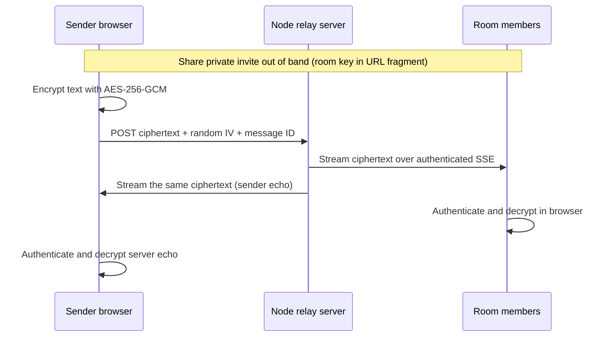

# Hush · a little more private.

A complete group chat application for the INS research project. A responsive cream-and-sage interface, private rooms, live member presence, and browser-side end-to-end encryption. No runtime packages, build step, or account signup.

## Run

Requires Node.js 22 or later.

```sh
npm start
```

Open **http://localhost:3000**. A private room is created automatically. Choose your display name with the profile button (applies to subsequent room joins), create a room, and use **Invite people**. Open the complete invite in another browser or private window, enter a name, and join. Multiple users can chat in the same room. The server supports up to 50 sessions per room.

```sh
npm test         # encryption and three-client relay integration tests
npm run dev      # restart server on source changes
```

The server defaults to `127.0.0.1:3000`. Set `HOST=0.0.0.0` and `PORT` as environment variables when hosting. To use an `.env` file, copy `.env.example` and run `node --env-file=.env server.mjs`.

**For people on different devices:** host this Node application behind an HTTPS reverse proxy and share that HTTPS address. Localhost links work only on the same computer. HTTPS is required for Web Crypto outside localhost. Keep streaming responses unbuffered and allow long-lived SSE connections. The proxy must preserve the original Host header (for example, Nginx `proxy_set_header Host $http_host; proxy_buffering off;`). This application needs a continuously running Node server; GitHub Pages alone cannot run its backend.

## Port already in use (`EADDRINUSE`)

Another process is listening on the requested port. Press **Ctrl+C** to stop the failed watcher, then choose another port.

Linux/macOS:

```sh
PORT=3001 npm run dev
```

Windows PowerShell:

```powershell
$env:PORT="3001"
npm run dev
```

Open **http://localhost:3001** on the computer running the server. If that port is occupied too, use `PORT=0` to let the operating system choose a free port and open the exact URL printed by Hush. The chosen port may change when the watcher restarts.

If Hush is already running in another terminal, you can instead keep using that instance, or stop it there with **Ctrl+C** before starting another. To inspect port 3000 on Linux without stopping anything, run `ss -ltnp 'sport = :3000'`. Do not stop an unfamiliar process just to free the port.

## How messages travel



The client uses the browser's built-in Web Crypto API. Each room gets an independently generated 256-bit AES key and a separate 256-bit access capability. Every encryption uses a random 96-bit IV; the relay rejects nonce reuse within a room. Authenticated additional data binds messages to room, sender session, and message ID. Room titles and display names are encrypted too. The server accepts only encrypted envelopes and binds posted messages to authenticated member sessions.

Invite links put both room key and room access capability after `#`. Browsers do not include this fragment in HTTP requests. On joining, the client sends only the **separate access capability**, never the encryption key, to the relay. A per-member bearer credential authenticates the streaming connection and message posts. Keys stay in the browser tab's session storage and are removed from the visible URL after joining. Server access credentials are stored hashed in memory. No third-party scripts, fonts, analytics, or external assets are loaded.

The encryption follows the Web Crypto [AES-GCM parameters](https://developer.mozilla.org/en-US/docs/Web/API/AesGcmParams) and [encrypt API](https://developer.mozilla.org/en-US/docs/Web/API/SubtleCrypto/encrypt).

## Features

- Create, search, switch, and leave private rooms.
- Share private invitations; choose a display name when joining.
- Live encrypted messages and member presence for multiple participants.
- Automatic reconnect, duplicate suppression, encrypted history replay, and draft preservation across room switches.
- Enter to send; Shift+Enter for a new line; slash to find a room.
- Responsive layout, keyboard-accessible dialogs, reduced-motion support, safe text rendering, and a room-key fingerprint for out-of-band comparison.
- Bounded room/member/message storage, message and room-creation rate limits, strict static file serving, CSP, same-origin checks, and encrypted payload validation.

## Security model and limitations

This is a research prototype, not an independently audited messaging protocol.

- Everyone with the invite can join, decrypt the latest retained messages, and share the key. Invite possession is membership; names are self-chosen, not independently verified. A shared group key does not provide cryptographic proof of an individual sender's identity.
- There is no forward secrecy, automatic key rotation, member removal, or revocation of existing invites. Create a new room and distribute its new invite to the remaining members when membership needs to change.
- The server sees room IDs, session IDs, connection metadata, ciphertext sizes, and timing. It does not receive room keys, message plaintext, profile plaintext, or room-title plaintext.
- As with any web-delivered cryptographic client, users must trust the client code and the host serving it. A compromised host can serve malicious JavaScript; HTTPS and an uncompromised browser/device are necessary. Session storage is accessible to same-origin JavaScript.
- The server retains the most recent **200 encrypted messages per room in memory**, not on disk. Restarting the server deletes rooms/history. Inactive rooms expire after 24 hours. Each room accepts at most 10,000 unique message IDs before a new room is required. This is a single-process implementation; horizontal replicas require coordinated state/pubsub.
- Reconnection replays retained history. Messages older than the 200-message window can be unavailable after an extended disconnection. “Relayed” means the server accepted and echoed the message, not that another user read it. Failed send attempts keep the draft; they are not automatically retried.
- Leaving removes this tab's saved room key. Closing a tab ends its session; disconnected server sessions expire after two minutes. Browser duplication/session recovery behavior may preserve session storage, so treat a device with saved room keys as trusted.

## Files

| Path | Purpose |
| --- | --- |
| `server.mjs` | HTTP API, authenticated SSE relay, room state, validation and headers |
| `public/index.html` | Accessible application layout and dialogs |
| `public/styles.css` | Responsive visual design |
| `public/app.js` | Room flows, presence, streaming and messaging UI |
| `public/crypto.js` | Browser-compatible AES-GCM and invite helpers |
| `test/chat.test.mjs` | Crypto, three-client relay, access-control and HTTP tests |

## Verification

`npm test` verifies Unicode round trips, fresh IV generation, tamper rejection, wrong-key rejection, context binding, three-member relay, encrypted reconnect history, duplicate suppression, room isolation, sender-session spoofing rejection, plaintext rejection, nonce reuse rejection, cross-origin protection, leave invalidation, invite fragment handling, and static file restrictions.
