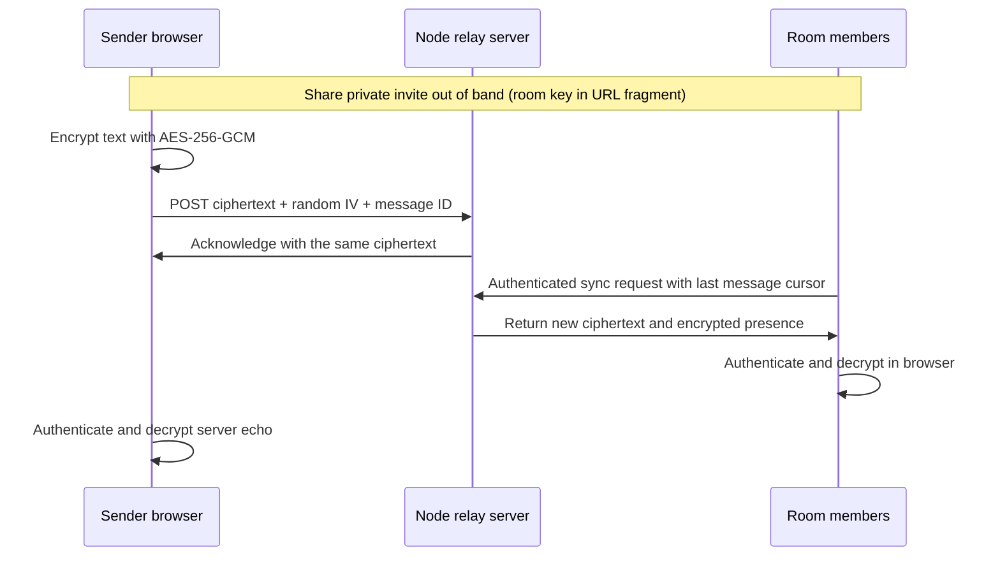

# Hush · a little more private.

A complete group chat application for the INS research project. A responsive cream-and-sage interface, private rooms, live member presence, and browser-side end-to-end encryption. No runtime packages, build step, or account signup.

## Run

Requires Node.js 22 or later.

```sh
npm start
```

Open **http://localhost:3000**. A private room is created automatically. Choose your display name with the profile button (applies to subsequent room joins), create a room, and use **Invite people**. Open the complete invite in another browser or private window, enter a name, and join. Multiple users can chat in the same room. The server supports up to 50 sessions per room.

```sh
npm ci           # install the frontend test dependency; running the app needs no packages
npm test         # encryption, relay, frontend flows, and startup integration tests
npm run dev      # restart server on source changes
```

The server defaults to `127.0.0.1:3000`. Set `HOST=0.0.0.0` and `PORT` as environment variables when hosting. To use an `.env` file, copy `.env.example` and run `node --env-file=.env server.mjs`.

**For people on different devices:** both people must connect to the **same server through the same HTTPS address**, then join using a full private invite. Running a separate server on each computer does not connect the two apps. Localhost links work only on the computer opening them. A plain HTTP LAN address does not enable Web Crypto; use HTTPS. The proxy must preserve the original Host header (for example, Nginx `proxy_set_header Host $http_host;`). GitHub Pages alone cannot run this backend.

## Chat with someone on another computer

### Temporary HTTPS link (same Wi-Fi or different networks)

1. Install the official [`cloudflared` binary](https://developers.cloudflare.com/cloudflare-one/networks/connectors/cloudflare-tunnel/downloads/) for your operating system and ensure it is on `PATH` (`cloudflared --version`).
2. In this project directory, run:

   ```sh
   npm run share
   ```

   This starts Hush on a free local port and exposes **this chat application** through a temporary public HTTPS tunnel. It does not require a Cloudflare account. The application is reachable at the tunnel address; private rooms still require their full secret invite.
3. Open the printed `https://…trycloudflare.com` URL in your browser. **Use that HTTPS page, not the localhost page**, to create your room.
4. Click **Invite people → Copy invite link** and send the complete link privately to the other person.
5. They open that exact link on their computer, enter their name, and join. They do not run a separate Node server. Both users should see the same short **Room ID** in the header and both names under **In the room**.
6. Keep the sharing terminal open. Ctrl+C stops both the tunnel and this server. Its rooms/history are in memory and will disappear when it stops.

If you already have Hush running on port 3001 and want to share **that instance**, use a second terminal:

```sh
cloudflared tunnel --url http://127.0.0.1:3001
```

Open its HTTPS URL before creating/copying the invite. Quick Tunnels are temporary development links, not permanent hosting; see [Cloudflare's documentation](https://developers.cloudflare.com/tunnel/get-started/quick-tunnels/). The updated browser client uses finite authenticated polling requests, so it does not depend on SSE support in the tunnel. A pre-existing Cloudflare tunnel configuration can interfere with Quick Tunnels; consult that documentation if cloudflared reports a configuration issue.

### Persistent hosted address

The repository includes `render.yaml` for a single Node web service with `HOST=0.0.0.0` and a health check. Import the repository as a Render Blueprint and review its service settings before deployment. Alternatively create a Node **Web Service** with build command `npm ci --omit=dev`, start command `npm start`, and environment variable `HOST=0.0.0.0`. Open its HTTPS URL and share room invites from there. No service has been deployed automatically. Keep one instance: room state is in process memory. Free services can sleep/restart, which clears this prototype's rooms.

### If you cannot see each other's messages

- Compare the short Room IDs, not just room names. Two separately created “The common room” rooms are unrelated. Join using **Invite people**, not **Create a room** on the second computer.
- Confirm that the invite uses the shared HTTPS address, not `localhost`, `127.0.0.1`, a private HTTP IP, or a different port/server.
- Run `git pull` and restart the server after updating; reload both browser tabs. An old browser client or an older Node process can still be serving the previous code.
- If the header says **Reconnecting**, wait for recovery or click **Reconnect**. Failed sends retain the draft. Retrying the same draft reuses the message ID, avoiding duplicates after a lost acknowledgement.
- If the server restarted, old rooms no longer exist. Create a new room and send its new invite. Share the visible error text when reporting a problem; never post the private invite key.

## Port already in use (`EADDRINUSE`)

Another process is listening on the requested port. Press **Ctrl+C** to stop the failed watcher, then choose another port.

Linux/macOS:

```sh
PORT=3001 npm run dev
```

Windows PowerShell:

```powershell
$env:PORT="3001"
npm run dev
```

Open **http://localhost:3001** on the computer running the server. If that port is occupied too, use `PORT=0` to let the operating system choose a free port and open the exact URL printed by Hush. The chosen port may change when the watcher restarts.

If Hush is already running in another terminal, you can instead keep using that instance, or stop it there with **Ctrl+C** before starting another. To inspect port 3000 on Linux without stopping anything, run `ss -ltnp 'sport = :3000'`. Do not stop an unfamiliar process just to free the port.

## How messages travel



The client uses the browser's built-in Web Crypto API. Each room gets an independently generated 256-bit AES key and a separate 256-bit access capability. Every encryption uses a random 96-bit IV; the relay rejects nonce reuse within a room. Authenticated additional data binds messages to room, sender session, and message ID. Room titles and display names are encrypted too. The server accepts only encrypted envelopes and binds posted messages to authenticated member sessions.

Invite links put both room key and room access capability after `#`. Browsers do not include this fragment in HTTP requests. On joining, the client sends only the **separate access capability**, never the encryption key, to the relay. A per-member bearer credential authenticates sync requests and message posts. Keys stay in the browser tab's session storage and are removed from the visible URL after joining. Server access credentials are stored hashed in memory. No third-party scripts, fonts, analytics, or external assets are loaded.

The active room polls for new ciphertext every 750 ms; background rooms poll every 2.5 seconds. Requests have a 10-second timeout and retry with backoff after a failure. No long-lived stream is held by the browser, preventing inactive rooms from exhausting HTTP/1 connection slots. The legacy SSE endpoint remains available for direct API clients and has separate integration coverage.

The encryption follows the Web Crypto [AES-GCM parameters](https://developer.mozilla.org/en-US/docs/Web/API/AesGcmParams) and [encrypt API](https://developer.mozilla.org/en-US/docs/Web/API/SubtleCrypto/encrypt).

## Features

- Create, search, switch, and leave private rooms.
- Share private invitations; choose a display name when joining.
- Live encrypted messages and member presence for multiple participants.
- Automatic reconnect, duplicate suppression, encrypted history replay, and draft preservation across room switches.
- Enter to send; Shift+Enter for a new line; slash to find a room.
- Responsive layout, keyboard-accessible dialogs, reduced-motion support, safe text rendering, and a room-key fingerprint for out-of-band comparison.
- Bounded room/member/message storage, message and room-creation rate limits, strict static file serving, CSP, same-origin checks, and encrypted payload validation.

## Security model and limitations

This is a research prototype, not an independently audited messaging protocol.

- Everyone with the invite can join, decrypt the latest retained messages, and share the key. Invite possession is membership; names are self-chosen, not independently verified. A shared group key does not provide cryptographic proof of an individual sender's identity.
- There is no forward secrecy, automatic key rotation, member removal, or revocation of existing invites. Create a new room and distribute its new invite to the remaining members when membership needs to change.
- The server sees room IDs, session IDs, connection metadata, ciphertext sizes, and timing. It does not receive room keys, message plaintext, profile plaintext, or room-title plaintext.
- As with any web-delivered cryptographic client, users must trust the client code and the host serving it. A compromised host can serve malicious JavaScript; HTTPS and an uncompromised browser/device are necessary. Session storage is accessible to same-origin JavaScript.
- The server retains the most recent **200 encrypted messages per room in memory**, not on disk. Restarting the server deletes rooms/history. Inactive rooms expire after 24 hours. Each room accepts at most 10,000 unique message IDs before a new room is required. This is a single-process implementation; horizontal replicas require coordinated state/pubsub.
- Reconnection replays retained history. Messages older than the 200-message window can be unavailable after an extended disconnection; a cursor gap is reported. “Relayed” means the server accepted and returned the encrypted message, not that another user read it. Failed send attempts keep the draft; they are not automatically retried. Clicking Send again retries the same encrypted envelope without duplicating an already accepted message.
- Leaving removes this tab's saved room key. Closing a tab ends its session; disconnected server sessions expire after two minutes. Browser duplication/session recovery behavior may preserve session storage, so treat a device with saved room keys as trusted.

## Files

| Path | Purpose |
| --- | --- |
| `server.mjs` | HTTP API, finite sync and legacy SSE relay, room state, validation and headers |
| `public/index.html` | Accessible application layout and dialogs |
| `public/styles.css` | Responsive visual design |
| `public/app.js` | Room flows, presence, sync/reconnect and messaging UI |
| `public/crypto.js` | Browser-compatible AES-GCM and invite helpers |
| `test/chat.test.mjs` | Crypto, three-client relay, access-control and HTTP tests |
| `test/frontend.test.mjs` | Actual frontend event handlers tested in isolated DOM sessions against the server |
| `test/startup.test.mjs` | Port conflicts, configuration, and share command failure handling |
| `share.mjs` | Explicitly started temporary HTTPS tunnel using official cloudflared |
| `render.yaml` | Optional single-instance hosted deployment configuration |

## Verification

`npm test` verifies Unicode round trips, fresh IV generation, tamper rejection, wrong-key rejection, context binding, three-member relay through both SSE and finite sync, encrypted history, duplicate suppression, room isolation, sender-session spoofing rejection, plaintext rejection, nonce reuse rejection, cross-origin protection, leave invalidation, invite fragment handling, static file restrictions, cursor handling and bounded history.

Frontend integration tests execute the actual `public/app.js` and HTML in isolated jsdom windows with real HTTP requests and Web Crypto. They exercise room creation, invitations, two-way messages, safe text rendering, member presence, leaving, room search, drafts, profile changes, security fingerprints, navigation controls, keyboard sending, wrong invite keys, room-name isolation, reload history, expired-session recovery, reconnecting, and retries after lost acknowledgements.

The automated frontend suite uses DOM/controller integration tests, not rendered Chrome/Firefox tests. A separate manual browser check on November 24, 2026 verified two independent browser sessions through an actual Cloudflare HTTPS tunnel: room creation, clipboard invitation, joining, messages in both directions, reload history, live membership, and messaging at a 390×844 mobile viewport. A collapsed member-list layout was found and fixed during this check. See `TESTING.md` for the verification record.

Two physically separate computers and their specific firewalls/networks were not available for testing. Native clipboard policies can also differ across browsers. The share command's missing-binary shutdown is covered by automation; the test suite itself never starts a public tunnel.
